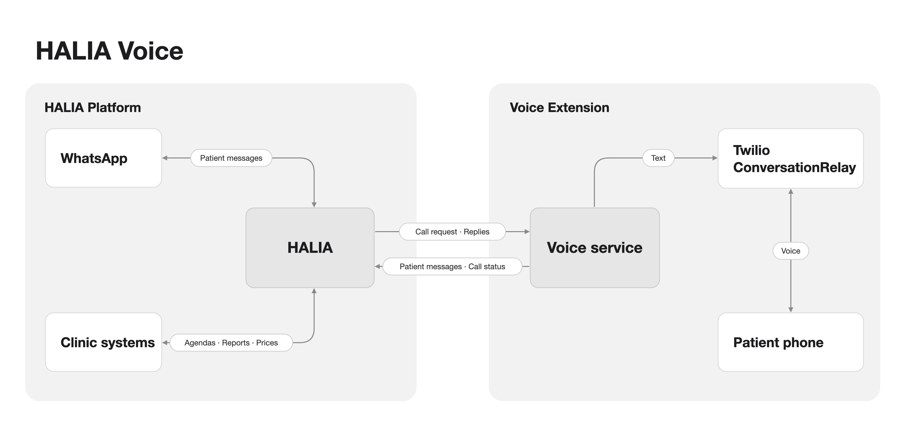

# HALIA Voice

A proposal for extending HALIA conversations with outbound phone calls. HALIA keeps the conversation context and every
business decision, for any of its processes: booking exams, report status, scheduled appointments, reminders,
cancellations, exam details and prices. The voice service runs the call and carries the messages.

1. **Start with [HALIA-Voice-Technical-Overview.pdf](HALIA-Voice-Technical-Overview.pdf)**: the architecture, the
   messages between the two systems, one request and its reply, and one call step by step.
2. **Then try [mock/](mock/)**: a runnable stand-in for HALIA in this message format. Instructions are in
   [mock/README.txt](mock/README.txt).

Prototype. Synthetic data only. All names, paths and fields are a proposal and open for discussion.
